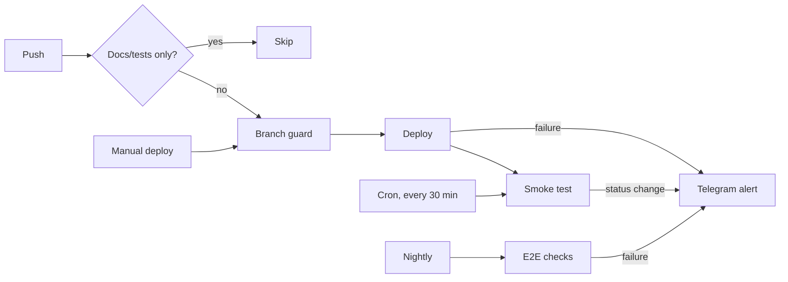

# Contributing

## Set up and validate

Use Node 24 (pinned in `.nvmrc`, which CI also reads) and the repository-pinned pnpm version. Unit tests and `pnpm check` also need Lua 5.4 with both `lua5.4` and `lua` on `PATH` (unit tests call each by name; if you only have one, symlink the other to it, as CI does) and `luacheck` 1.2.0 (`luarocks --lua-version=5.4 --local install luacheck 1.2.0`). From the repository root:

```sh
pnpm install --frozen-lockfile
pnpm test:unit
pnpm check
pnpm build
```

`pnpm test:unit` runs the discovered tests under `happyview-modules/tests/unit`; unit tests use local fixtures and fake process/network adapters, and do not seed a database or contact HappyView. `pnpm check` also checks generated-source freshness, JavaScript and Lua lint, types, endpoint tests, and the `@hypercerts-org/api` package in `packages/api/`. `pnpm build` emits Lua handlers declared by the root and module manifests, builds the endpoint explorer, and builds `@hypercerts-org/api`. Shared Lua files are bundled into capability handlers rather than installed independently.

The list-endpoint golden (`happyview-modules/tests/unit/list-golden/`) pins the SQL, binds and outcomes of every cursor-taking query. It reads the _generated_ Lua bundles, not `lua/shared` or `lua/src`, so run `pnpm --filter @hypercerts-org/happyview-modules run build:lua` after editing those before running `pnpm test:unit`. After an intended behavior change, rebuild, then regenerate with `UPDATE_GOLDEN=1 pnpm test:unit` and review the diff.

## API reference snapshots

When a change affects registered query Lexicons or their schemas, refresh the committed explorer artifacts from the current API manifest:

```sh
pnpm docs:sync
```

This updates `docs/sources/index.json`, the committed Lexicon snapshots, and both OpenAPI snapshots. It uses the repository-pinned `@hypercerts-org/lexicon` dependency and makes no HappyView requests. See [docs/README.md](docs/README.md) for the source and snapshot policy.

The same changes, and changes to the `@hypercerts-org/lexicon` or `@atproto/lex` version in `packages/api/package.json`, require regenerating the `@hypercerts-org/api` TypeScript package:

```sh
pnpm client:generate
```

`pnpm check` fails while the committed output in `packages/api/src/` is stale. See [packages/api/README.md](packages/api/README.md).

## HTTP runtime tests

`pnpm test:http` runs the suites in `happyview-modules/tests/http` against the actor, activity, badge-definition, badge-query, EVM-link, acknowledgement, collection, context-measurement, context attachment and evaluation, contributor-information, funding, location, profile, organization, feature, work-scope-tag, rights, vocabulary-tag, graph, contribution, and feed-reaction query XRPC endpoints installed from this checkout. These tests exercise real HTTP behavior against PostgreSQL, not only Lua handlers with a fake database.

The local runner requires a local Docker Compose daemon, `psql`, and the pinned PostgreSQL and HappyView images already cached locally. Set `PSQL_PATH` to the absolute path of a trusted `psql` executable:

```sh
PSQL_PATH="$(command -v psql)" pnpm test:http
```

Locally, Compose uses `--pull never`; if a pinned image is missing, the test fails before service startup. CI explicitly pulls the two digest-pinned test images before running the same command.

The runner discovers `*.http.test.js` suites and `*.fixture.js` fixture modules, then creates a random Compose project with loopback-only dynamic ports, PostgreSQL data on tmpfs, and a task-owned default bridge network. It installs this checkout's manifest, seeds shared and HTTP fixtures, runs the suites, and tears down only that generated Compose project and its temporary credentials. Fixtures are seeded only into the task-owned disposable database; fixture SQL helpers require an explicit disposable loopback database opt-in.

The bridge network permits container egress. HappyView receives loopback placeholder upstream URLs and proxy variables pointing to `127.0.0.1:9`; these are application-level settings, not network-level egress isolation. The installer and HTTP suites target only the task-owned loopback service.

The HTTP gate fails if it discovers no suites, executes no `node:test` cases, or runs only skipped cases. Current coverage includes:

- Funding record retrieval, repeated filters, publisher-sidecar hydration, and pagination.
- Badge-definition retrieval with an icon and allowed-issuer list, publisher-sidecar hydration, author and badge-type filters, `createdAt`/URI pagination ties, and named error responses.
- Rights record retrieval and author-filtered listing, nullable publisher sidecars, repeated-author OR filtering, and stable `createdAt`/URI cursor pagination.
- EVM-link lookup and listing, actor/address filters, `createdAt`/URI pagination ties in both directions, nullable sidecar hydration, and named error responses.
- Feature-query coverage in `happyview-modules/tests/http/features.http.test.js` exercises exact retrieval and hydrated or absent author sidecars, author/type and organization-presence filters, bidirectional `createdAt`/URI pagination ties, and named request errors.
- Contributor-information retrieval by exact AT-URI and listing with repeated-author filters, cursor pagination, hydrated and missing author sidecars, and named runtime errors.
- Work-scope-tag exact-URI retrieval, repeated-author filtering with an empty-result case, hydrated and null publisher sidecars, middle-position `indexedAt` fallback, tied pagination in both directions, and named error responses.
- Context-measurement exact retrieval and publisher-sidecar hydration, repeated author/subject filters and negative results, timestamp/URI tie pagination in both directions, missing sidecars, and named runtime errors.
- Acknowledgement exact retrieval and full-record preservation, hydrated and absent publisher sidecars, repeated author/subject filters, ascending and descending pagination across timestamp ties, and named errors.
- Badge-query baseline-aware definition feeds and discriminating filters, exact-version award/response lookups, recipient status, opt-in award totals across filters and past-the-end pages, raw response history, bidirectional tied pagination, nullable sidecars, and named runtime errors.
- Actor lookups by DID, including ordered duplicates, unknown actors, profile and organization projections, raw URI-matched primary locations, and named request errors.
- Profile and organization queries across all four endpoints for each record type, including batch null results, profile-sidecar hydration, filters, `createdAt`/URI pagination ties, and named errors.
- Vocabulary-tag exact-URI retrieval, repeated-author filtering and no-match behavior, hydrated and nullable sidecars, bidirectional pagination ties, unsupported-search rejection, and named errors.
- Context attachment and evaluation retrieval with publisher/evaluator sidecar hydration, list filters, pagination across tied `createdAt` values, and named runtime errors. Batched comment counts cover per-record counting, CID-independent subject matching, excluded non-comment attachments, and agreement with `listAttachments`.
- Activity retrieval with contributor-sidecar hydration, author/organization/contributor/URI filters, tied timestamp pagination, and literal wildcard search.
- Collection retrieval with CBOR-derived CIDs, location/tag projections, author, organization, item and tag filters, title/shortDescription search, `createdAt`/URI pagination ties, and source-order item pagination with exact-version resolution.
- Graph actor/entity lookups and lists, tied-key pagination, nullable profile/organization sidecars, entity target resolution, entity-follower totals across pages and empty pages, the global recent-follows `before` filter, and exclusion of legacy project follows (a `via` collection owned by the followed DID) across follow lookups, lists, counts, and the recent feed while real `via` follows stay. The `getFollows` and `getEntityFollows` batch queries also cover repeated target order and duplicates, explicit target keys, nullable raw views, and invalid-entry rejection. The `getFollowerCounts` batch covers mixed DID and entity subjects, input order and duplicates, deduplicated publishers, zero counts, agreement with each list endpoint's `totalCount`, and invalid-subject rejection.
- Feed-reaction subject and actor queries, earliest duplicate selection, URI-only subject matching across CIDs, distinct-actor totals, tied cursor pagination, page-only sidecar hydration, raw `via`/signature preservation, and actor queries without hydration.
- Contribution exact-record retrieval, repeated publisher filters, tied ascending/descending cursor pagination, nullable publisher sidecars, and named errors.
- Badge, badge-query, acknowledgement, contribution, and rights HTTP fixtures with CBOR-derived record CIDs; contribution DIDs are distinct from baseline fixture identities.
- Location retrieval with nullable sidecars, repeated author/URI/location-type filters, unsupported-search errors, tied pagination in both directions, malformed/absent `createdAt` handling, and named errors.
- HTTP fixtures for activity, collection, funding, badge-definition, badge-query, EVM-link, acknowledgement, feature, work-scope-tag, contribution, contributor-information, actor, context-measurement, context attachment and evaluation, graph, location, measurement, and vocabulary-tag records use CBOR-derived CIDs.

For the pinned HappyView release, ordinary Lua `error()` exceptions return HTTP 500 JSON with `error: "script_error"` and `errorType: "runtime"`; the error name appears in `message`. Negative HTTP tests assert this observed behavior. It is not a statement of the ideal public HTTP status contract, and does not guarantee 4xx mapping for `RecordNotFound` or `InvalidRequest`.

## Smoke and e2e checks against a live API

Two read-only runners check a deployed API. They send anonymous `GET` requests only and never write.

```sh
API_BASE_URL=https://test.api.hypercerts.dev pnpm smoke   # one call per installed query, about 10 seconds
API_BASE_URL=https://test.api.hypercerts.dev pnpm e2e     # pagination walks, batches, count invariants, about 1-2 minutes
```

`--base-url <url>` works instead of `API_BASE_URL`. Run them against Test; Staging and Production are checked by CI.

- **Smoke** (`pnpm smoke`) calls every installed query once and checks that the answer has the right shape. It runs after each deploy and every 30 minutes on Production.
- **E2E** (`pnpm e2e`) does slower checks: it pages through lists, sends big batches and compares counts between endpoints. It runs nightly at 03:17 UTC on Test, Staging and Production.
- To force a deploy, run the Deploy workflow by hand from the environment's branch. Pushes that only change docs, tests or tooling skip the deploy.
- A new query needs a case in `happyview-modules/tooling/smoke-cases.js`, or `pnpm test:unit` fails.
- The API URLs for smoke and e2e are written in `smoke.yml` and `e2e-nightly.yml`; change them there if a URL changes.
- A failed deploy or e2e run sends a short Telegram message with a link to the run. The smoke test (after each deploy, and every 30 minutes on Production) sends a message only when its status changes: one when it starts failing, naming the failing checks, and one when it recovers. While it keeps failing or keeps passing, it stays silent. The alerts need the repository secrets `TELEGRAM_BOT_TOKEN` and `TELEGRAM_CHAT_ID`; without them they are skipped.

How the post-deploy checks fit together (`deploy.yml`, `smoke.yml`, `e2e-nightly.yml`):



- **Push:** to `main`, `staging` or `production`. If every changed file is in the workflow's `paths-ignore` (docs, tests, tooling), there is no deploy and no smoke test.
- **Branch guard:** the `resolve` job maps `main` to Test, `staging` to Staging and `production` to Production. A manual dispatch must pick the environment that matches its branch, and an optional rollback commit must be a full SHA.
- **Deploy:** one `deploy` job per environment, never cancelled midway; it runs `install:api --override`, then the smoke test in the same job so the deploy lock covers it.
- **Smoke test (`pnpm smoke`):** entered after a deploy, or from `smoke.yml` (Production every 30 minutes, or on demand for any environment).
  - Phase 1 calls the list endpoints and collects seed records; an entity-follow discovery step follows; phase 2 runs the lookups that need those seeds.
  - Every response is checked against its Lexicon output schema and the invariants (page size, `totalCount`, count order, `uri` echo).
  - Manifest coverage: every installed query must have a smoke case.
- **E2E checks (`pnpm e2e`):** `e2e-nightly.yml` at 03:17 UTC, Test, then Staging, then Production. Pagination walks (at most 60 pages), 100-subject batches, and loosely compared cross-endpoint counts.
- **Retries:** both runners' HTTP client retries a timeout or network error 3 times (1s, 2s, 4s); 4xx and 5xx responses fail at once.
- **Telegram alert:** sent if the `TELEGRAM_*` secrets are set.
  - A failed deploy (before the smoke test), a `smoke.yml` run that fails before its smoke test finishes, and a failed e2e run alert every time.
  - The smoke test alerts only when its result differs from the previous run whose smoke test finished: one failure message when it starts failing, one "recovered" message when it passes again, nothing in between. Cancelled and skipped runs are ignored.
  - `smoke.yml` compares with the previous run of the same environment (matched by its run name, `Smoke <environment>`), by the result of its smoke step. The post-deploy smoke test compares with the previous deploy to the same branch whose smoke test finished. The two do not see each other's results.
  - With no previous result to compare (first run, no comparable recent run, GitHub API read fails), a failure alerts and a pass stays silent.
  - The previous runs are read with the job's `GITHUB_TOKEN` (`actions: read`); nothing else is stored. The logic is in `.github/actions/telegram-alert/status-change.mjs`.
  - Sending an alert never changes the job result.
- Both runners write a results table to the GitHub step summary.

## Operations with external effects

For pull requests that change the installable API bundle or operator-visible behavior, add a release note following the [Changesets guidance](.changeset/README.md). Documentation-only or endpoint-explorer-only changes do not need a Changeset.

`pnpm install:api` sends admin requests to a HappyView instance and uploads declared assets. By default, conflicting declared assets stop the install before asset writes; `pnpm install:api --override` explicitly replaces only those conflicts. Override does not bypass source/dependency validation or authentication. If a write request errors, the installer checks the installed asset and treats it as complete only if it matches the bundle. Writes are not rolled back if a later asset fails. Run the installer only for an explicitly approved target with an approved token. Review the target and release notes before installing a released bundle; see [happyview-modules/README.md](happyview-modules/README.md) for release installation and the optional `HYPERCERTS_HANDLE_RESOLVER_URL` override (the installer never touches it).
